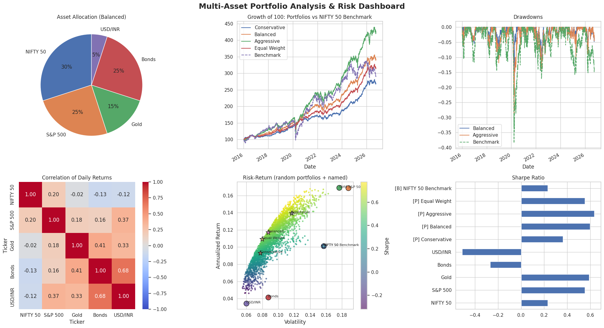

# Multi-Asset Portfolio Analysis & Risk Dashboard

A Python project that builds four multi-asset portfolios from an Indian investor's point of view and compares them against a NIFTY 50 benchmark on return, risk and drawdown.



## Assets (2016 – 2026, daily data from Yahoo Finance)

| Asset | Source | Notes |
|---|---|---|
| NIFTY 50 | `^NSEI` | Indian equities, also used as the benchmark |
| S&P 500 | `^GSPC` | Converted to INR |
| Gold | `GC=F` | COMEX gold futures, converted to INR |
| Bonds | `IEF` | US 7-10Y Treasury ETF, converted to INR |
| USD/INR | `USDINR=X` | Held as a small currency position |

## Portfolios tested

| Portfolio | NIFTY 50 | S&P 500 | Gold | Bonds | USD/INR |
|---|---|---|---|---|---|
| Conservative | 15% | 10% | 20% | 50% | 5% |
| Balanced | 30% | 25% | 15% | 25% | 5% |
| Aggressive | 45% | 40% | 10% | 0% | 5% |
| Equal Weight | 20% | 20% | 20% | 20% | 20% |

## Metrics computed

Annualized return (CAGR), annualized volatility, Sharpe ratio, Sortino ratio, maximum drawdown, Calmar ratio, total return, and the correlation matrix of daily returns. 3,000 random weight combinations are also simulated to show the risk-return trade-off.

## Results

| Portfolio | Ann. Return | Volatility | Sharpe | Max Drawdown |
|---|---|---|---|---|
| NIFTY 50 (benchmark) | 10.1% | 15.7% | 0.23 | -38.4% |
| Conservative | 9.3% | 7.8% | 0.36 | -9.6% |
| Balanced | 11.7% | 8.7% | 0.60 | -17.1% |
| Aggressive | 13.9% | 11.7% | 0.64 | -28.7% |
| Equal Weight | 10.9% | 8.0% | 0.55 | -12.0% |

## Key findings

1. **Diversification cut risk sharply.** The Balanced portfolio had about 45% lower volatility than NIFTY 50 (8.7% vs 15.7%) and less than half the maximum drawdown (-17% vs -38%).
2. **It improved return too.** Balanced earned 11.7% a year vs 10.1% for NIFTY 50, and its Sharpe ratio was 0.60 vs 0.23.
3. **Low correlations drive this.** NIFTY 50 was almost uncorrelated with gold (-0.02) and slightly negatively correlated with bonds (-0.13), so losses in equities were partly offset elsewhere.
4. **More risk bought more return, with diminishing benefit.** Aggressive had the highest return (13.9%) and Sharpe (0.64), but also the deepest drawdown of the four portfolios (-28.7%).
5. **Bonds and USD/INR had negative Sharpe ratios** because their returns (4.2% and 3.4%) were below the 6.5% risk-free rate used. This hurt the Conservative portfolio, which is 50% bonds.
6. **Bonds and USD/INR are highly correlated (0.68)**, so holding both adds less diversification than it seems.

## Assumptions and limitations

- Risk-free rate is assumed at 6.5% (approx. India 10Y G-Sec yield).
- Portfolios are rebalanced daily to fixed weights, with no transaction costs or taxes.
- US assets (S&P 500, gold, bonds) are measured in INR, so part of their return comes from rupee depreciation against the dollar.
- Bonds are US Treasuries, not Indian government bonds.
- Results are historical for one period and do not predict future performance.
- Gold uses continuous futures prices, which can contain small roll-over effects. An earlier version using `GOLDBEES.NS` was dropped because of bad price data.

## How to run

```
pip install yfinance pandas numpy matplotlib seaborn
python portfolio_analysis.py
```

Outputs are saved to the `output/` folder: `dashboard.png`, `metrics.csv`, `correlation.csv`.

## Possible extensions

- Monthly or quarterly rebalancing instead of daily
- Value at Risk (VaR) and Conditional VaR
- Efficient frontier optimization and rolling-window metrics
- An Indian gilt ETF as the bond leg
- A Streamlit app for interactive weights
